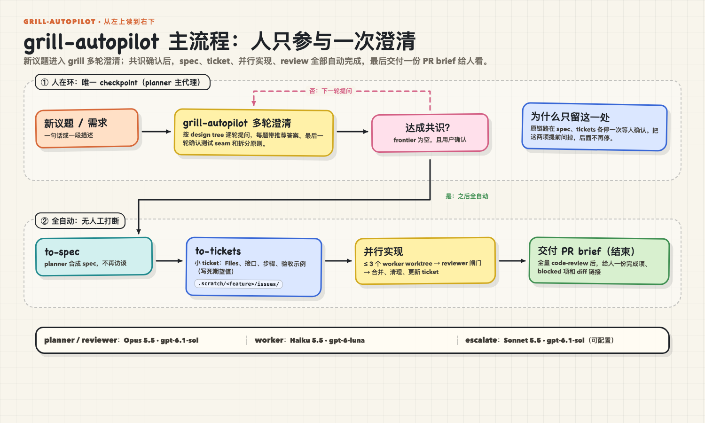
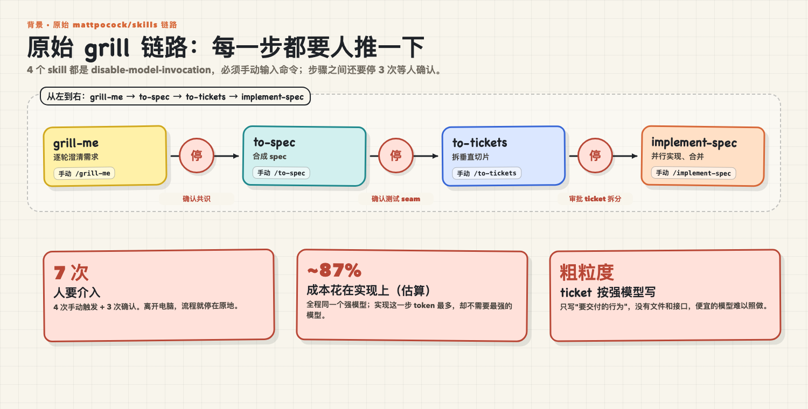
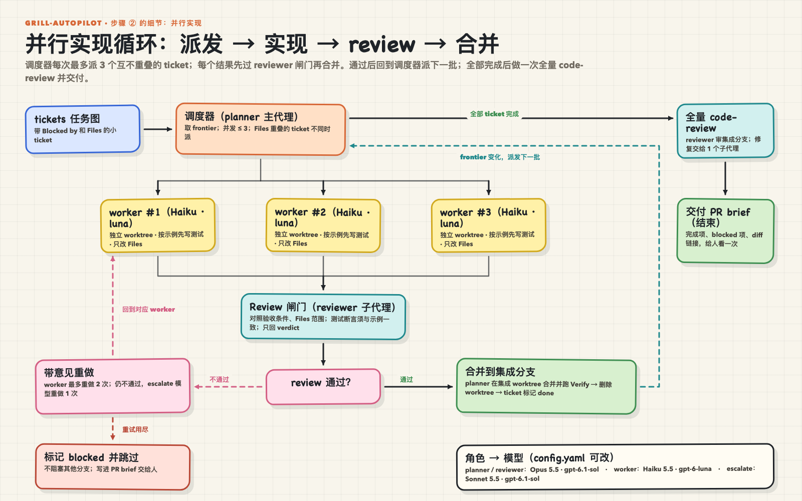
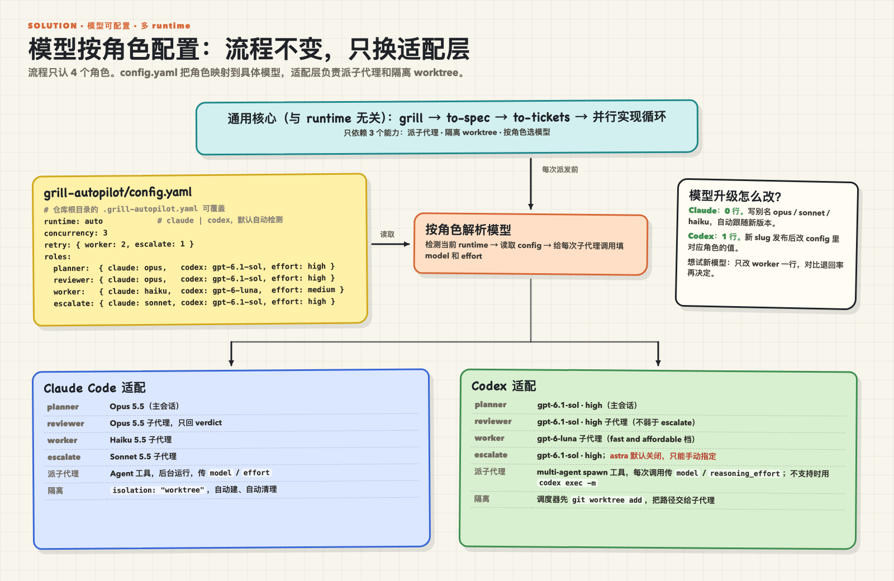
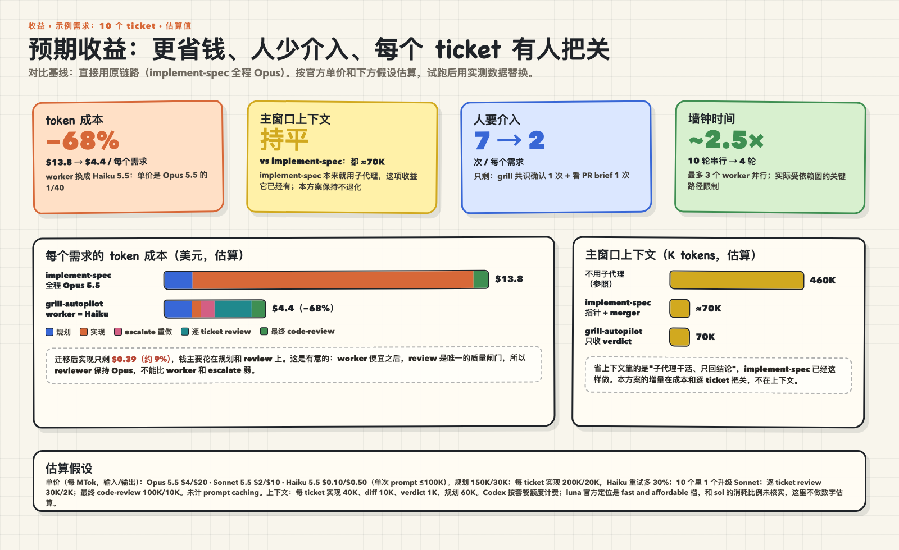

# grill-autopilot

**被 grill 一次，剩下的交给 autopilot。**

你给一个新议题，agent 先像 [`/grill-me`](https://github.com/mattpocock/skills) 一样把需求问清楚。你确认一次之后，它自己写 spec、拆 ticket、在多个 worktree 里并行实现、每个 ticket 合并前单独 review，最后交给你一份 PR brief。

规划和 review 用强模型，实现用便宜模型。模型按角色配置，Claude Code 和 Codex 都能用。



> 状态：实验阶段。流程和规则已经写完，下面的收益数字是估算值。欢迎提交真实运行数据（见 [贡献](#贡献)）。

## 它解决什么问题

[mattpocock/skills](https://github.com/mattpocock/skills) 的 `grill-me → to-spec → to-tickets → implement-spec` 是一条很好的链路，但每一步都要人推一下，而且全程用同一个模型。



grill-autopilot 不重写这些 skill，而是把它们串起来，并加上三样东西：

1. **一个入口、一次确认**：to-spec 的 seam 确认和 to-tickets 的拆分审批，都提前到 grill 的最后一轮问掉。
2. **按角色选模型**：planner、reviewer、worker、escalate 四个角色，各自配置模型。
3. **worker 能照做的 ticket，加上逐个 review**：便宜的模型只做定义清楚的小 ticket，每个 ticket 合并前都由强模型把关。

## 和直接用 implement-spec 比

implement-spec 已经会按依赖图并行派子代理，也会用 worktree，但它不切换模型，也不逐个 review。

| | 直接用 implement-spec | grill-autopilot |
|---|---|---|
| 实现用的模型 | 继承主会话（通常是 Opus） | worker 角色（默认 Haiku / gpt-6-luna） |
| ticket 粒度 | 按强模型估算的垂直切片 | 写明 Files、接口、示例值的小切片 |
| 合并前把关 | 只有最后一次 code-review | 每个 ticket 一次 review，最后再做一次全量 code-review |
| 失败处理 | 未定义 | worker 重做 2 次 → escalate 1 次 → 标记 blocked |
| 人工介入 | 链路上要停 3 次，手动触发 4 次 | grill 结束确认 1 次，最后看 brief 1 次 |
| 主窗口上下文 | 已经很省（子代理 + 指针） | 持平 |

核心收益来自三件事一起用：便宜的 worker、worker 能照做的 ticket、逐个 review。只换模型会提高失败率；只加 review 是白花钱。

## 快速开始

### 1. 前置条件

- [Claude Code](https://code.claude.com) 或 [Codex CLI](https://github.com/openai/codex)。
- 已安装 [mattpocock/skills](https://github.com/mattpocock/skills#installation-30-second-setup)，用 plugin 或 `npx skills` 安装都可以。grill-autopilot 会用到其中的 `grilling`、`to-spec`、`to-tickets`、`tdd`、`code-review` 和 `setup-matt-pocock-skills`。
- 一个 git 仓库，tracked 源码状态干净，明确初始化命令（或 `None`）、单票检查、全量测试和 typecheck（不适用则约定 `N/A` 及理由）。已有无关 untracked 文件会记录并保留。

### 2. 安装

```bash
git clone https://github.com/<owner>/grill-autopilot.git ~/grill-autopilot
```

Claude Code：

```bash
ln -s ~/grill-autopilot/skills/grill-autopilot ~/.claude/skills/grill-autopilot
```

Codex：

```bash
ln -s ~/grill-autopilot/skills/grill-autopilot ~/.codex/skills/grill-autopilot
```

用软链接安装，之后 `git pull` 就能更新。

### 3. 使用

在仓库里输入：

```text
/grill-autopilot 给报表页加 CSV 导出
```

1. agent 先列出本次每个角色用的模型，然后开始一轮一轮提问，每个问题都附带推荐答案。
2. 最后一轮会确认测试 seam、拆分原则、初始化与检查命令（包括 `None`/`N/A` 的明确选择）、分支名，以及结束时要不要推送。
3. 你回答 "Go" 之后就可以离开。之后它不会再问你任何问题。
4. 回来看 `.scratch/<slug>/brief.md`。

中断后显式输入 `/grill-autopilot resume <run-id>`。agent 先核对原 run record、输入/companion 指纹、宿主活动和 Git 现场，再继续原阶段；活跃 attempt 继续观察，已合并的候选按验证证据核对，歧义则保留现场并报告 failed。新议题不会因同 slug 自动进入恢复。主会话崩溃后不保证即时 brief 或后台自动续跑，规则见 [resume.md](skills/grill-autopilot/resume.md)。

## 运行后会留下什么

```text
.scratch/<slug>/
├── spec.md             # 派发前确认的规格；后续假设记入 run record
├── issues/01-*.md …    # 每个 ticket 一个文件，Status 和 Comments 记录每次尝试
├── runs/<run-id>/
│   ├── run.md          # 唯一运行记录：身份、路径、角色、尝试、SHA、事件与证据
│   └── snapshots/      # spec 与 ticket 任务正文的只读快照，不含可变 Status/Comments
└── brief.md            # 最终报告：完成项、blocked 项、假设、模型分工

分支 autopilot/<slug>/integration    # 集成分支，所有通过 review 的 ticket 都合并到这里
分支 autopilot/<slug>/tickets/<NN>   # 每张 ticket 的分支，与 integration ref 可同时存在
../<repo>.autopilot-worktrees/   # blocked 保留完整 worktree/分支；成功票通过清理门槛才删除，集成 worktree 保留
```

原 checkout 允许 planner 写本次运行明确拥有的 tracker 资料；源码修改和合并都在专用 worktree 里进行。运行前后核对原 checkout 的 ref、base SHA、tracked diff 和无关 untracked 文件；不会把整个 `.scratch/` 都当作可覆盖的目录。worker/reviewer 通过 canonical 绝对路径读同一份快照，无需把未提交运行资料写入 base。路径、权限和字段见 [run record 契约](skills/grill-autopilot/run-record.md)。

每次运行有独立 run ID；slug 是功能名，不是恢复授权。创建前会保存 base commit SHA，并检查实际 ref 的 Git 合法性、前缀冲突、已存在的分支和 worktree 路径。旧式 `autopilot/<slug>` 或同 slug 的残留现场会让新运行停止并报告冲突，保留已有 ref、文件和未提交修改。只有明确恢复同一次运行并核对现场后才可复用。命令与失败出口见 [Setup](skills/grill-autopilot/loop.md#setup)；可复现的 Git 行为证据见 [ticket 01 验证记录](docs/verification/reliability-hardening/01/README.md)。

## 它是怎么工作的



- **派发**：从依赖图里取出可以开工的 ticket，最多同时 3 个；改动文件重叠的 ticket 不会同时跑。
- **准备**：每个集成/ticket worktree 单独初始化并运行本阶段基线，原 checkout 的 ignored 依赖不会自动带过去。初始化/原始基线失败记录为环境错误，保留现场与命令证据，在环境修好前不进入实现、不消耗实现重试次数。
- **实现**：每个 worker 在自己的 worktree 里，按 ticket 里写死的示例值先写测试再实现，只能改 ticket 声明的文件。
- **把关**：reviewer 核对验收条件、文件范围，检查测试断言是否和示例值一致、有没有被放宽，然后只回一行 `PASS` 或 `FAIL`。
- **合并**：通过后合并到集成分支并重新验证，先记录 done；仅在分支已合入、现场 clean、属于本 run 且没有活跃 agent 时清理该票。删除失败记 cleanup warning，保留已验证结果和集成 worktree，继续 brief。
- **失败**：带着 review 意见在原现场重做，保留前一次未提交修改；次数用完标记 blocked，保留 tracked/untracked 文件、worktree、分支和诊断，先停止本 run 的写入 agent，brief 列出路径和 dirty/活动状态。依赖它的票也 blocked，其余票继续。无法确认活动或所有权的现场保留，不强制删除或 reset。
- **收尾**：全量 code-review → 修复 → 跑全量测试 → 写 brief。

细节见 [`skills/grill-autopilot/loop.md`](skills/grill-autopilot/loop.md) 和 [`tickets.md`](skills/grill-autopilot/tickets.md)。

## 配置模型



默认配置在 [`skills/grill-autopilot/config.yaml`](skills/grill-autopilot/config.yaml)：

```yaml
roles:
  planner:  { claude: opus,   codex: gpt-6.1-sol, effort: high }    # grill、spec、tickets、调度
  reviewer: { claude: opus,   codex: gpt-6.1-sol, effort: high }    # 逐个 review、最终 code-review
  worker:   { claude: haiku,  codex: gpt-6-luna,  effort: medium }  # 实现一个 ticket
  escalate: { claude: sonnet, codex: gpt-6.1-sol, effort: high }    # worker 失败后重做
```

- **按仓库覆盖**：在仓库根目录放一个 `.grill-autopilot.yaml`，里面写的键优先。
- **升级模型**：Claude 用别名（`opus` / `sonnet` / `haiku`），出新版本自动跟上；Codex 写具体型号，出新型号改一行。
- **reviewer 不能比 worker 和 escalate 弱**：它是便宜 worker 唯一的质量关口。
- **Codex 的 astra 档默认不用**：只有在配置里写了它才会用。

## 预期收益



以一个 10 个 ticket 的需求为例，按官方单价估算，对比直接用 implement-spec（全程 Opus）：

- **token 成本约 −68%**：Haiku 5.5 的单价是 Opus 5.5 的 1/40。
- **人工介入从 7 次降到 2 次**。
- **每个 ticket 合并前都有 review**。
- **主窗口上下文持平**：implement-spec 本来就做到了这一点。

这些都是估算值，假设写在图的底部，没有计入 prompt caching。Codex 按套餐额度计费，没有给出数字。

## 安全边界

- 只在专用集成/ticket worktree 提交产品修改；planner 独占写原 checkout 内本 run 明确拥有的 tracker 资料。保留 base ref、原 checkout 的源码和无关文件，并在 brief 附上前后核对证据。
- 只有你在 grill 里选了推送才会推送，从不 force-push。
- 某个角色配置的模型不可用时，直接停下并报告，不会偷偷换成别的模型。
- 派发后新假设和事件记入 run record；需要扩大范围则 block，并写进 brief，保持已分发的 spec/ticket 题目不变。

## 已知限制

- **还没有大规模验证。** 收益是估算值，ticket 粒度的规则也需要更多真实项目来校准。
- **Companion 需要通过当前契约检查。** 按相邻、项目、用户三个层级选一套完整集合，检查必要辅助文件、步骤语义和模板；同级不同指纹先选择，缺失或不兼容则在 Go 前报告。恢复前核对来源和实际内容 hash，漂移时保留现场并停止。文件名存在不代表兼容任意上游版本，规则见 [companions.md](skills/grill-autopilot/companions.md)。
- **需要能跑的测试命令。** 没有测试的仓库不适合这种自动化方式。
- **ticket 只存本地 markdown。** 不会写入 GitHub Issues、Jira 等外部系统。
- **Codex 适配**：优先用 multi-agent spawn 工具，按调用传 `model`；不支持时退回 `codex exec`，需要子进程能联网。

## 卸载

```bash
rm ~/.claude/skills/grill-autopilot ~/.codex/skills/grill-autopilot
```

这两个都只是软链接，删掉不会影响克隆下来的仓库。

## 贡献

最有价值的贡献是**真实运行数据**。跑完一次之后，欢迎提一个 issue 附上：

- ticket 数量、review 退回率、escalate 次数、blocked 数量；
- token 用量（例如 Claude Code 的 `/cost`）和总耗时；
- 哪类 ticket worker 做不好。

有了这些数据，才能把上面的估算换成实测值，并校准 [`tickets.md`](skills/grill-autopilot/tickets.md) 里的粒度规则。

## 致谢

建立在 Matt Pocock 的 [mattpocock/skills](https://github.com/mattpocock/skills)（MIT）之上。grilling、to-spec、to-tickets、tdd、code-review 的方法都来自那里；本仓库只负责把它们串起来，并加上模型分工和逐个 review。

## License

[MIT](LICENSE)
