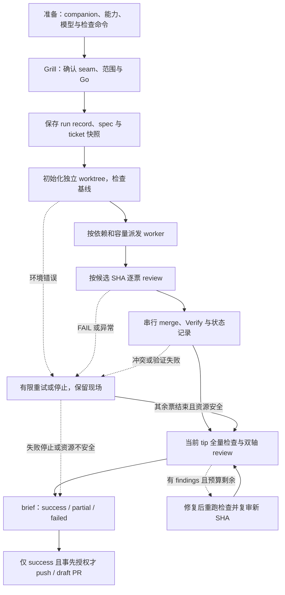

# grill-autopilot

**被 grill 一次，剩下的交给 autopilot。**

你给一个新议题，agent 先像 [`/grill-me`](https://github.com/mattpocock/skills) 一样把需求问清楚。你确认一次之后，它自己写 spec、拆 ticket、在多个 worktree 里并行实现、每个 ticket 合并前单独 review，最后交给你一份 PR brief。

规划和 review 请求更强的模型，实现请求更便宜的模型。配置按角色声明；当前会话、宿主能力和路由策略决定实际可用的执行方式。Claude Code 与 Codex 的适配契约见 [runtimes.md](skills/grill-autopilot/runtimes.md)，验证范围见下方矩阵。

> 状态：实验阶段。已有文档/Git/schema 证据和一次真实 native Python fixture 成功；dirty 失败保存与实际中断恢复仍未验证，不承诺整个产品规格完成、总体省钱比例或加速倍数。



图展示主路径；重试预算、停止与结果以 [failures.md](skills/grill-autopilot/failures.md) 为准。协议由当前会话执行，尚无独立执行引擎。

## 它解决什么问题

[mattpocock/skills](https://github.com/mattpocock/skills) 的 `grill-me → to-spec → to-tickets → implement-spec` 是一条很好的链路，但每一步都要人推一下，而且全程用同一个模型。

grill-autopilot 不重写这些 skill，而是把它们串起来，并加上三样东西：

1. **一个入口、一次确认**：to-spec 的 seam 确认和 to-tickets 的拆分审批，都提前到 grill 的最后一轮问掉。
2. **按角色选模型**：planner、reviewer、worker、escalate 四个角色，各自配置模型。
3. **worker 能照做的 ticket，加上逐个 review**：便宜的模型只做定义清楚的小 ticket，每个 ticket 合并前都由强模型把关。

## 角色分工的目的

| 机制 | 目的与限制 |
| --- | --- |
| worker 处理具体小票 | 减少单次实现需要的上下文；是否降低总成本取决于 token、缓存和失败次数。 |
| 合并前逐票 review | 对固定候选 SHA 核对验收、范围和测试；review 本身也消耗资源。 |
| 依赖与 Files 自检 | 只调度依赖满足且文件范围不冲突的票；文件隔离不能替代业务依赖。 |
| 有界失败出口 | worker 最多 3 次实现，再 escalate 1 次；每个候选仍需 review，耗尽后 blocked。 |

这些是设计目的，尚无同任务对照实验支撑总体成本、速度或人工介入次数的改善结论。

## 快速开始

### 1. 前置条件

- [Claude Code](https://code.claude.com) 或 [Codex CLI](https://github.com/openai/codex)。
- 已安装 [mattpocock/skills](https://github.com/mattpocock/skills#installation-30-second-setup)，用 plugin 或 `npx skills` 安装都可以。grill-autopilot 会用到其中的 `grilling`、`to-spec`、`to-tickets`、`tdd`、`code-review` 和 `setup-matt-pocock-skills`。
- 一个 git 仓库，tracked 源码状态干净，明确初始化命令（或 `None`）、单票检查、全量测试和 typecheck（不适用则约定 `N/A` 及理由）。已有无关 untracked 文件会记录并保留。

### 2. 安装

克隆到你维护的源码目录；默认位置如下。已有 checkout 时先核对 remote，直接使用它，不重复 clone 或覆盖目录。

```bash
git clone https://github.com/miniLV/grill-autopilot.git "$HOME/grill-autopilot"
```

选择一个宿主的 skills 目录后运行下面的安装块。默认是 Codex；Claude Code 将 `autopilot_skills` 改为 `$HOME/.claude/skills`。改用其他 checkout 时同时修改 `autopilot_checkout`；这两个变量也供临时验证重定向路径。

```bash
(
  autopilot_checkout="${autopilot_checkout:-$HOME/grill-autopilot}"
  autopilot_skills="${autopilot_skills:-$HOME/.codex/skills}"
  autopilot_source="$autopilot_checkout/skills/grill-autopilot"
  autopilot_target="$autopilot_skills/grill-autopilot"
  if [ ! -f "$autopilot_source/SKILL.md" ]; then
    printf 'Missing skill source: %s\n' "$autopilot_source" >&2
    exit 1
  fi
  mkdir -p "$autopilot_skills" || exit 1
  if [ -L "$autopilot_target" ] && [ "$(readlink "$autopilot_target")" = "$autopilot_source" ]; then
    printf 'Already installed: %s\n' "$autopilot_target"
  elif [ -e "$autopilot_target" ] || [ -L "$autopilot_target" ]; then
    printf 'Conflict; preserved: %s\n' "$autopilot_target" >&2
    exit 1
  else
    ln -s "$autopilot_source" "$autopilot_target"
  fi
)
```

同一源码路径的已安装链接可重复运行；其他文件、目录、不同目标链接与悬空链接都报冲突并保留。相同目录但使用不同链接写法也需人工核对。保留这个 checkout 作为维护源，检查更新后在其中执行 `git pull`；软链接随源码更新。此安装只链接 grill-autopilot，companion 集合仍需独立通过 [companions.md](skills/grill-autopilot/companions.md) 的完整性、语义和指纹检查。

### 3. 使用

在仓库里输入：

```text
/grill-autopilot 给报表页加 CSV 导出
```

1. agent 先披露各角色请求的模型/effort、可信观察值或 `unknown`，以及宿主能力、容量和限制，再开始澄清需求。
2. 最后一轮会确认测试 seam、拆分原则、初始化与检查命令（包括 `None`/`N/A` 的明确选择）、分支名，以及结束时要不要推送。
3. 你回答 "Go" 后按已确认范围继续；新问题记为假设或 blocked，处理得了的停止路径写 brief。有限等待依赖可用宿主能力；无法确认资源停止时保留现场并报告 failed。
4. 回来看 `.scratch/<slug>/brief.md`。

中断后显式输入 `/grill-autopilot resume <run-id>`。agent 先核对原 run record、输入/companion 指纹、宿主活动和 Git 现场，再继续原阶段；活跃 attempt 继续观察，已合并的候选按验证证据核对，歧义则保留现场并报告 failed。新议题不会因同 slug 自动进入恢复。主会话崩溃后不保证即时 brief 或后台自动续跑，规则见 [resume.md](skills/grill-autopilot/resume.md)。

## 运行后会留下什么

```text
.scratch/<slug>/
├── spec.md             # 派发前确认的规格；后续假设记入 run record
├── issues/01-*.md …    # 每个 ticket 一个文件，Status 和 Comments 记录每次尝试
├── runs/<run-id>/
│   ├── run.md          # 唯一运行记录：身份、路径、角色、尝试、SHA、事件与证据
│   └── snapshots/      # spec 与 ticket 任务正文的只读快照，不含可变 Status/Comments
└── brief.md            # 最终报告：完成项、blocked 项、假设、模型分工

分支 autopilot/<slug>/integration    # 集成分支，所有通过 review 的 ticket 都合并到这里
分支 autopilot/<slug>/tickets/<NN>   # 每张 ticket 的分支，与 integration ref 可同时存在
../<repo>.autopilot-worktrees/   # blocked 保留完整 worktree/分支；成功票通过清理门槛才删除，集成 worktree 保留
```

原 checkout 允许 planner 写本次运行明确拥有的 tracker 资料；源码修改和合并都在专用 worktree 里进行。运行前后核对原 checkout 的 ref、base SHA、tracked diff 和无关 untracked 文件；不会把整个 `.scratch/` 都当作可覆盖的目录。worker/reviewer 通过 canonical 绝对路径读同一份快照，无需把未提交运行资料写入 base。路径、权限和字段见 [run record 契约](skills/grill-autopilot/run-record.md)。

每次运行有独立 run ID；slug 是功能名，不是恢复授权。创建前会保存 base commit SHA，并检查实际 ref 的 Git 合法性、前缀冲突、已存在的分支和 worktree 路径。旧式 `autopilot/<slug>` 或同 slug 的残留现场会让新运行停止并报告冲突，保留已有 ref、文件和未提交修改。只有明确恢复同一次运行并核对现场后才可复用。命令与失败出口见 [Setup](skills/grill-autopilot/loop.md#setup)；可复现的 Git 行为证据见 [ticket 01 验证记录](docs/verification/reliability-hardening/01/README.md)。

## 它是怎么工作的

- **派发**：从依赖图里取出可以开工的 ticket，默认 worker 上限 3 个；所有子角色共享宿主 slots，优先为待 review 的票释放并确认可用容量。容量 unknown 时从一个 child 开始；文件重叠的票不并行。
- **准备**：每个集成/ticket worktree 单独初始化并运行本阶段基线，原 checkout 的 ignored 依赖不会自动带过去。初始化/原始基线失败记录为环境错误，保留现场与命令证据，在环境修好前不进入实现、不消耗实现重试次数。
- **实现**：每个 worker 在自己的 worktree 里，按 ticket 里写死的示例值先写测试再实现，只能改 ticket 声明的文件。
- **把关**：reviewer 核对验收条件、文件范围，检查测试断言是否和示例值一致、有没有被放宽，返回 `PASS` / `FAIL`、固定比较基点、reviewed SHA 与验证证据；候选随后变化会使原 PASS 失效。
- **合并**：通过后合并到集成分支并重新验证，先记录 done；仅在分支已合入、现场 clean、属于本 run 且没有活跃 agent 时清理该票。删除失败记 cleanup warning，保留已验证结果和集成 worktree，继续 brief。
- **失败**：带着 review 意见在原现场重做，保留前一次未提交修改；次数用完标记 blocked，保留 tracked/untracked 文件、worktree、分支和诊断，先停止本 run 的写入 agent，brief 列出路径和 dirty/活动状态。依赖它的票也 blocked，其余票继续。无法确认活动或所有权的现场保留，不强制删除或 reset。
- **收尾**：当前集成 SHA 跑全量测试/适用的 typecheck，并做 Standards、Spec 双轴 review；有 findings 才修复，默认最多 2 轮。每次修改重跑检查并复审新 SHA，最后核对 tip 未变再写 brief。已知 blocked 是未交付范围，不免除其余 findings。

细节见 [`skills/grill-autopilot/loop.md`](skills/grill-autopilot/loop.md) 和 [`tickets.md`](skills/grill-autopilot/tickets.md)。

## 配置模型

默认配置在 [`skills/grill-autopilot/config.yaml`](skills/grill-autopilot/config.yaml)：

```yaml
roles:
  planner:  { claude: opus,   codex: gpt-6.1-sol, effort: high }    # grill、spec、tickets、调度
  reviewer: { claude: opus,   codex: gpt-6.1-sol, effort: high }    # 逐个 review、最终 code-review
  worker:   { claude: haiku,  codex: gpt-6-luna,  effort: medium }  # 实现一个 ticket
  escalate: { claude: sonnet, codex: gpt-6.1-sol, effort: high }    # worker 失败后重做
```

- **按仓库覆盖**：在仓库根目录放一个 `.grill-autopilot.yaml`，里面写的键优先。
- **请求与观察分开**：Claude 别名由宿主解析，Codex 使用型号；接受参数、CLI flags 或 child 自报都不证明实际匹配。可信元数据缺失时保持 `unknown`，已观察 mismatch 则停止该子角色并保留现场。planner 保持当前会话模型。
- **reviewer 的配置应至少与 worker / escalate 同样有能力**：角色配置表达期望，不是效果或实际路由的保证。
- **路由可能不可用**：不支持所需能力时，仅在 CLI 路径本身获准的情况下 fallback；策略、模型、权限或原因不明的拒绝不能靠 CLI 绕过。见 [runtime 契约](skills/grill-autopilot/runtimes.md#fallback-gate)。

## 结果、预算与运行证据

| 结果 | 条件与交付 |
| --- | --- |
| `success` | 全票 done，当前 tip 的最终检查和双轴 review 通过；事先授权时才可 push / draft PR。 |
| `partial` | 至少一票 done、一票 blocked，已集成范围的最终检查和双轴 review 通过；brief 明列未交付需求，保持本地。 |
| `failed` | 无完成项、最终验证/findings 未解决，或无法安全恢复/停止资源；保存现场、原因和可得证据，保持本地。 |

默认 attempt 期限 1800 秒，含初始化、等待和角色执行；同一逻辑 attempt 的瞬时基础设施错误最多额外重试 1 次，不重置时钟。worker 的 2 次额外实现、escalate 的 1 次实现、review 调用与 2 轮最终修复分别记数。到期请求取消并核对活动；无法确认停止时停派发、停清理并保留可能仍被写入的现场。规则见 [failures.md](skills/grill-autopilot/failures.md)。

成本与耗时应作为每次运行的证据附在 run record / brief 中：

| 字段 | 记录要求 |
| --- | --- |
| 模型与 effort | 每角色/attempt 的 requested、可信 observed、match/mismatch/unknown 与来源。 |
| token 与缓存 | 输入、输出、缓存读/写 token 分开；宿主不给数据则逐项 `unknown`。 |
| review 与重试 | review 调用、实现、escalate、基础设施重试、最终修复的次数和可得费用分开。 |
| 成本与时间 | 计费口径、实际费用、各 attempt 开始/结束和总墙钟耗时；缺失则 `unknown`，不由单价比例推算节省。 |

尚未取得完整运行的成本、token、缓存、review 费用、重试分布与总耗时数据，这些值目前是 `unknown`。没有同任务、同验收范围的对照基线，就不报告节省百分比或加速倍数。

## 当前验证范围

[ticket 13 真实试运行](docs/verification/reliability-hardening/13/README.md) 取得一次 native Python fixture 完整成功；此前 CLI launch 与后来的 native fresh start 分别被所选路由拒绝。dirty 失败保存与实际中断恢复仍未验证，该验证票受阻。

| 路径 | 已取得的证据 | 仍未验证 |
| --- | --- | --- |
| Codex native | [实际 schema](docs/verification/reliability-hardening/06/host-schema.md) 与 [单个 Python fixture 的真实 skill success](docs/verification/reliability-hardening/13/native/README.md)：3票、14测试、最终双轴 PASS 绑定同一 SHA；后续执行续用已有 identity。另一次 fresh gpt-6.1-sol/high start 被当前 registry 拒绝；trusted actual model/effort 为 `unknown`。 | dirty tracked/untracked 失败保存、实际 planner 中断/恢复；fresh start 可用性；真实取消；metadata 删除不支持。不能由 retained identity 的 continuation 推出新派发可用或整体兼容。 |
| Codex CLI（主机试运行；fallback 另按契约） | [version/help](docs/verification/reliability-hardening/06/cli-help.log) 与 [真实受拒 launch](docs/verification/reliability-hardening/13/README.md)：0.156.0 在本次 ChatGPT account 路由拒绝 gpt-6.1-sol/high，exit 1，owned 进程已退出；actual model/effort 为 `unknown`。 | 完整 skill 成功、dirty 工作保存、显式恢复；实际模型执行、取消/容量归还。7.454 秒仅为受拒 launch；metadata/传输 fallback 不表示换模型。 |
| Claude native | 当前宿主未暴露 Claude Agent schema。 | 能力、actual model/effort 与完整运行均未验证。 |
| Claude CLI fallback | 同份只读 help 记录版本 2.1.292，检查 agents/logs/stop/rm 语法。 | 模型派发和生命周期、完整运行；`rm` 可能删除 worktree，不用于常规释放。 |
| 文档与临时 fixture | [验证目录](docs/verification/reliability-hardening/) 区分 Git、手动协议、raw CLI 输出、root 规范化的实际 native 事件与命令捕获；[安装/渲染](docs/verification/reliability-hardening/12/README.md)、[保留的基线/历史/原 checkout 比较](docs/verification/reliability-hardening/13/native/README.md)。 | 基线或一个 fixture success 不能推出 dirty 失败保存、恢复、整个产品规格或其他 runtime 兼容；session-only root Git/data helpers 不是生产执行引擎。 |

这些是带日期的证据快照，不能证明所有宿主、模型或 companion 版本兼容。准备时仍需检查当前能力和授权；另一 runtime 无真实日志时保持未验证。

## 安全边界

- 只在专用集成/ticket worktree 提交产品修改；planner 独占写原 checkout 内本 run 明确拥有的 tracker 资料。保留 base ref、原 checkout 的源码和无关文件，并在 brief 附上前后核对证据。
- 只有 `success` 且你事先选了推送才可自动 push / draft PR；`partial` / `failed` 默认本地，从不 force-push。
- 某个角色配置的模型不可用时，直接停下并报告，不会偷偷换成别的模型。
- 派发后新假设和事件记入 run record；需要扩大范围则 block，并写进 brief，保持已分发的 spec/ticket 题目不变。

## 已知限制

- **只有一个 native Python fixture 的真实成功，完整失败/恢复验收仍未完成，也没有规模或收益 benchmark。** ticket 粒度、预算与实际成本需要更多真实项目数据校准。
- **Companion 需要通过当前契约检查。** 按相邻、项目、用户三个层级选一套完整集合，检查必要辅助文件、步骤语义和模板；同级不同指纹先选择，缺失或不兼容则在 Go 前报告。恢复前核对来源和实际内容 hash，漂移时保留现场并停止。文件名存在不代表兼容任意上游版本，规则见 [companions.md](skills/grill-autopilot/companions.md)。
- **需要能跑的测试命令。** 没有测试的仓库不适合这种自动化方式。
- **ticket 只存本地 markdown。** 不会写入 GitHub Issues、Jira 等外部系统。
- **可用 runtime 是准备门槛。** start/result/liveness/有界等待等必要能力缺失且无获准 fallback 时停止；不可取消的调用不能承诺后台继续运行或及时收尾。schema、help 与真实运行证据的范围见上表。

## 卸载

使用安装时同样的 checkout 和宿主目录，一次处理一个链接。只有目标是指向该源码路径的软链接才删除；不存在时跳过，其他文件/目录/链接报冲突并保留。源码已移除时，这个检查仍可删除自己拥有的悬空链接。

```bash
(
  autopilot_checkout="${autopilot_checkout:-$HOME/grill-autopilot}"
  autopilot_skills="${autopilot_skills:-$HOME/.codex/skills}"
  autopilot_source="$autopilot_checkout/skills/grill-autopilot"
  autopilot_target="$autopilot_skills/grill-autopilot"
  if [ -L "$autopilot_target" ] && [ "$(readlink "$autopilot_target")" = "$autopilot_source" ]; then
    rm "$autopilot_target"
  elif [ -e "$autopilot_target" ] || [ -L "$autopilot_target" ]; then
    printf 'Conflict; preserved: %s\n' "$autopilot_target" >&2
    exit 1
  else
    printf 'Not installed: %s\n' "$autopilot_target"
  fi
)
```

这只删除已核对的链接，克隆下来的维护源码保留。

## 贡献

最有价值的贡献是**真实运行数据**。跑完一次之后，欢迎提一个 issue 附上：

- ticket 数量、review 退回率、escalate 次数、blocked 数量；
- token 用量（例如 Claude Code 的 `/cost`）和总耗时；
- 哪类 ticket worker 做不好。

请附 runtime/版本、请求与实际观察的模型/effort，以及上述逐项 `unknown`；对照实验需写明任务、验收范围和基线。有了这些数据，才能判断成本与速度，并校准 [`tickets.md`](skills/grill-autopilot/tickets.md) 里的粒度规则。

## 致谢

建立在 Matt Pocock 的 [mattpocock/skills](https://github.com/mattpocock/skills)（MIT）之上。grilling、to-spec、to-tickets、tdd、code-review 的方法都来自那里；本仓库只负责把它们串起来，并加上模型分工和逐个 review。

## License

[MIT](LICENSE)
