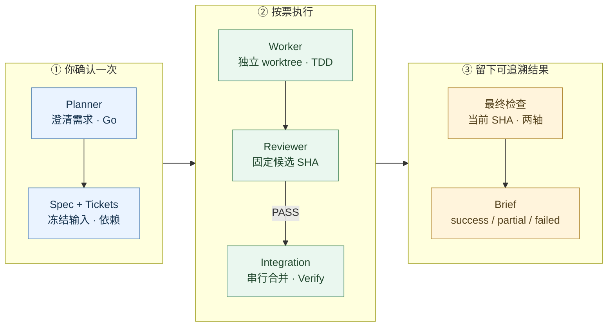

# grill-autopilot

**被 grill 一次，剩下的交给 autopilot。**

一个入口串起需求澄清、spec、tickets、独立 worktree 实现与逐票 review。你确认范围后，agent 按角色请求模型，最后交付可追溯的 brief。

> 实验阶段：加固完成 12/13 票。单个真实 fixture 成功；dirty 故障保留和实际中断恢复仍待验证。

## 一张图看流程



失败按预算重试或交给 **escalate**；耗尽后 blocked 并保留现场。最终修复后重跑检查和双轴审查。规则见 [失败处理](skills/grill-autopilot/failures.md) 与 [最终审查](skills/grill-autopilot/final-review.md)。协议由当前会话执行，依赖可用宿主能力。

## 快速开始

### 1. 前置条件

使用 Claude Code 或 Codex；安装完整的 [mattpocock/skills](https://github.com/mattpocock/skills) companion 集合。Git 源码需干净，并约定初始化命令、单票检查、全量测试及 typecheck；不适用的检查须明确 N/A 理由。[准备与 companion 规则](skills/grill-autopilot/companions.md)

### 2. 安装

已有 checkout 时先核对 remote，直接使用它。新安装先克隆：

```bash
git clone https://github.com/miniLV/grill-autopilot.git "$HOME/grill-autopilot"
```

<details>
<summary>展开安全安装命令（Codex / Claude Code）</summary>

默认安装到 Codex；Claude Code 将 `autopilot_skills` 改为 `$HOME/.claude/skills`。使用其他 checkout 时修改 `autopilot_checkout`。相同源码链接可重复安装，其他已有文件或链接会保留并报冲突。

```bash
(
  autopilot_checkout="${autopilot_checkout:-$HOME/grill-autopilot}"
  autopilot_skills="${autopilot_skills:-$HOME/.codex/skills}"
  autopilot_source="$autopilot_checkout/skills/grill-autopilot"
  autopilot_target="$autopilot_skills/grill-autopilot"
  if [ ! -f "$autopilot_source/SKILL.md" ]; then
    printf 'Missing skill source: %s\n' "$autopilot_source" >&2
    exit 1
  fi
  mkdir -p "$autopilot_skills" || exit 1
  if [ -L "$autopilot_target" ] && [ "$(readlink "$autopilot_target")" = "$autopilot_source" ]; then
    printf 'Already installed: %s\n' "$autopilot_target"
  elif [ -e "$autopilot_target" ] || [ -L "$autopilot_target" ]; then
    printf 'Conflict; preserved: %s\n' "$autopilot_target" >&2
    exit 1
  else
    ln -s "$autopilot_source" "$autopilot_target"
  fi
)
```

保留 checkout 作为维护源，核对更新后执行 `git pull`。此安装只链接本 skill，companion 需独立完成契约检查。

</details>

### 3. 使用

```text
/grill-autopilot 给报表页加 CSV 导出
```

确认 seam、范围、检查命令与交付方式后回答 **Go**。结果在 `.scratch/<slug>/brief.md`，记录包含每票状态、独立 run ID、冻结输入和验证证据。

中断后显式恢复：

```text
/grill-autopilot resume <run-id>
```

恢复先核对输入、宿主活动与 Git 现场；主会话崩溃后需显式恢复。[恢复协议](skills/grill-autopilot/resume.md)

## 当前验证状态


2026-10-14：已交付协议在 [8d947f5](https://github.com/miniLV/grill-autopilot/commit/8d947f583d31f47dd19833fe36f612dd55f0fc08) 通过 Standards / Spec 双轴审查；8 组隔离 Git/layout/install 检查通过。真实 native 成功只覆盖一个 Python fixture；指定模型的新启动曾被拒绝，其他 runtime 的完整流程仍未验证。实际模型/effort 元数据、完整运行成本与速度收益保持 unknown。

[执行索引](.scratch/reliability-hardening/README.md) · [真实试运行与缺口](docs/verification/reliability-hardening/13/README.md) · [全部验证证据](docs/verification/reliability-hardening/)

## 配置与详细规则

在项目根目录的 `.grill-autopilot.yaml` 覆盖 [默认角色配置](skills/grill-autopilot/config.yaml)。模型配置表达请求；可信实际元数据缺失时记录 unknown，模型不可用时停止该角色并保留现场。

| 想了解 | 阅读 |
| --- | --- |
| 依赖、worktree、逐票 review 与合并 | [实现循环](skills/grill-autopilot/loop.md) · [ticket 契约](skills/grill-autopilot/tickets.md) |
| 宿主能力、模型事实与全部角色容量 | [runtime 契约](skills/grill-autopilot/runtimes.md) |
| 输入快照、tracker 所有权与留存记录 | [run record](skills/grill-autopilot/run-record.md) |
| 超时、重试、恢复与最终结果 | [失败处理](skills/grill-autopilot/failures.md) · [恢复](skills/grill-autopilot/resume.md) · [最终审查](skills/grill-autopilot/final-review.md) |

产品修改在专用 worktree，原 checkout 的 tracker 写入受明确所有权约束。blocked 保留 dirty 文件、分支与诊断；**只有 success 且事先授权才自动 push / draft PR**，partial / failed 默认留在本地，从不 force push。

## 卸载

<details>
<summary>展开安全卸载命令</summary>

使用安装时相同的 checkout 和宿主目录；只删除核对过的源码软链接，其他目标保留。维护源码不会删除。

```bash
(
  autopilot_checkout="${autopilot_checkout:-$HOME/grill-autopilot}"
  autopilot_skills="${autopilot_skills:-$HOME/.codex/skills}"
  autopilot_source="$autopilot_checkout/skills/grill-autopilot"
  autopilot_target="$autopilot_skills/grill-autopilot"
  if [ -L "$autopilot_target" ] && [ "$(readlink "$autopilot_target")" = "$autopilot_source" ]; then
    rm "$autopilot_target"
  elif [ -e "$autopilot_target" ] || [ -L "$autopilot_target" ]; then
    printf 'Conflict; preserved: %s\n' "$autopilot_target" >&2
    exit 1
  else
    printf 'Not installed: %s\n' "$autopilot_target"
  fi
)
```

</details>

## 贡献

欢迎提交真实运行数据：runtime/版本、请求与实际模型、ticket/review/retry/blocked 数量、可观测的 token/缓存/费用/时间，以及逐项 unknown。成本或速度对照请使用同任务、同验收范围的基线。

建立在 Matt Pocock 的 [mattpocock/skills](https://github.com/mattpocock/skills)（MIT）之上。本仓库负责串起流程、角色分工与逐票 review。[MIT License](LICENSE)
